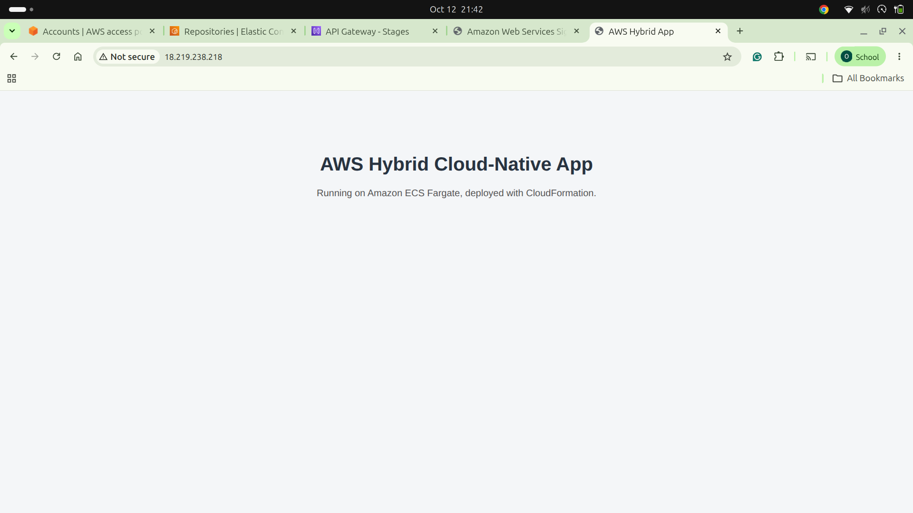
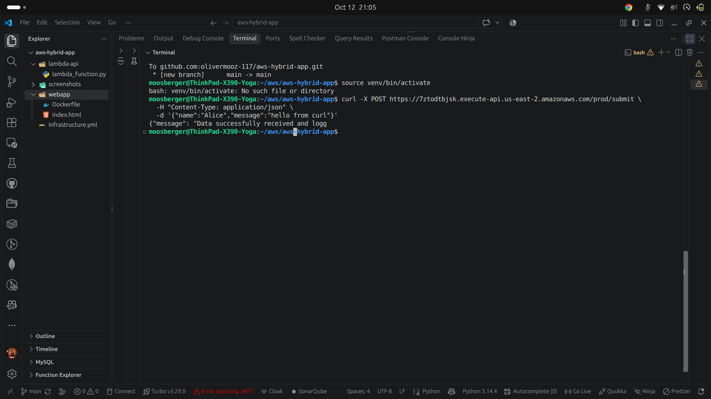
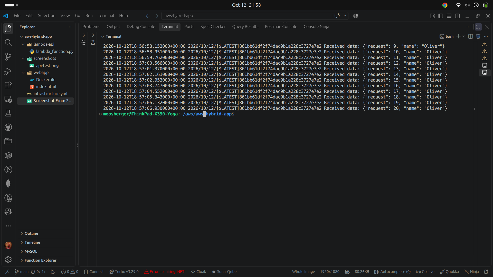
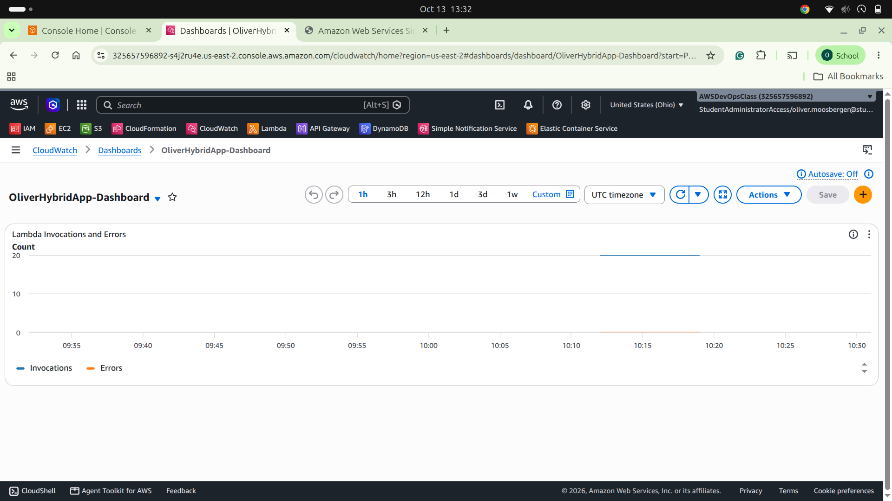

# AWS Hybrid Cloud-Native App

A hybrid cloud-native application built for the DevOps capstone. A serverless REST API receives JSON data, a containerized web app runs on ECS Fargate (deployed with CloudFormation), and CloudWatch monitors the setup.

**Region:** us-east-2 (Ohio)

## Architecture

| Component | Service | Purpose |
|---|---|---|
| Serverless API | API Gateway + Lambda (Python) | `POST /submit` accepts JSON, logs it, returns an ID |
| Container app | ECS Fargate + ECR | Nginx static site served from a Docker image |
| Infrastructure as Code | CloudFormation | Provisions the ECS cluster, task definition, service, security group, IAM role and log group |
| Observability | CloudWatch | Lambda logs and a dashboard of invocations and errors |

## Repository structure

.
├── infrastructure.yml # CloudFormation template (ECS Fargate)
├── lambda-api/
│ └── lambda_function.py # Lambda handler
├── webapp/
│ ├── Dockerfile
│ └── index.html
├── screenshots/
└── README.md


## Setup and deployment

### 1. Lambda and API Gateway
1. Create a Lambda function `capstone-submit-function` (Python runtime) with the code in `lambda-api/lambda_function.py`.
2. Create a REST API `capstone-api` with a `/submit` resource and a `POST` method using **Lambda proxy integration**.
3. Deploy the API to a stage named `prod`.
4. Test:
```bash
   curl -X POST https://7ztodtbjsk.execute-api.us-east-2.amazonaws.com/prod/submit \
     -H "Content-Type: application/json" \
     -d '{"name":"Alice","message":"hello from curl"}'
```

### 2. Container image to ECR
```bash
aws ecr create-repository --repository-name capstone-webapp --region us-east-2
aws ecr get-login-password --region us-east-2 | docker login --username AWS --password-stdin <account-id>.dkr.ecr.us-east-2.amazonaws.com
cd webapp
docker build --platform linux/amd64 -t capstone-webapp .
docker tag capstone-webapp:latest <account-id>.dkr.ecr.us-east-2.amazonaws.com/capstone-webapp:latest
docker push <account-id>.dkr.ecr.us-east-2.amazonaws.com/capstone-webapp:latest
```

### 3. Deploy the ECS stack with CloudFormation
```bash
aws cloudformation deploy \
  --region us-east-2 \
  --template-file infrastructure.yml \
  --stack-name capstone-ecs \
  --capabilities CAPABILITY_IAM \
  --parameter-overrides \
    ImageUri=<account-id>.dkr.ecr.us-east-2.amazonaws.com/capstone-webapp:latest \
    VpcId=<vpc-id> \
    SubnetIds=<subnet-1>,<subnet-2>
```
The template creates the cluster, task definition, Fargate service, security group (port 80), task execution role and a log group, so no manual steps are required.

### 4. Observability
1. Send traffic to the API and load the web app.
2. Verify the Lambda logs in CloudWatch Logs group `/aws/lambda/capstone-submit-function`.
3. Create a CloudWatch dashboard with a line widget showing Lambda **Invocations** and **Errors**.

## Screenshots

### Live ECS web application


### Successful API Gateway test


### CloudWatch Lambda logs


### CloudWatch dashboard (Invocations and Errors)


## Cleanup
```bash
aws cloudformation delete-stack --stack-name capstone-ecs --region us-east-2
```
Also delete the ECR repository, the API, the Lambda function and the dashboard when no longer needed.